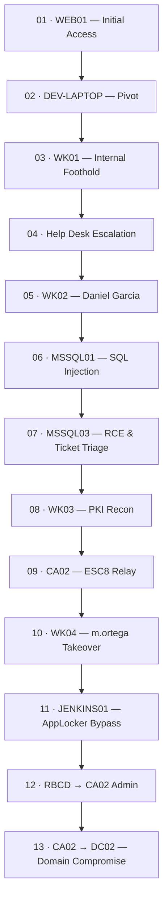

# Apexfiend — Attack Chain Write-ups

This folder contains the full technical write-ups for the Apexfiend Active Directory lab: real commands, real output, and the reasoning behind each step. Where `docs/08-attack-paths/` explains *why* each path works at a reasoning level, these files show *how* — exactly as executed against the lab.

> **Scope note:** All hosts, IPs, and identities referenced here belong to the private, isolated Apexfiend lab. No real authentication material (plaintext secrets, ticket dumps, hashes) is reproduced verbatim in these files — command syntax and output format are shown with placeholders (e.g. `<NTLM_HASH>`, `<TGT>`) where a real value would otherwise appear; fill those in locally from your own lab output when attaching screenshots.

## How to read this

The chain is sequential: each file assumes everything in the files before it has already happened. Start at `01` and follow the numbers in order, or jump directly to the stage you're interested in — each file's **Prerequisites** section tells you exactly what access/credentials you need in hand before starting it, and links back to where that access was obtained.

## Attack Chain at a Glance



## Stage Summary

| # | File | Host(s) | Starting Point | Outcome |
|---|---|---|---|---|
| 01 | `01-web01-initial-access.md` | WEB01 | Unauthenticated, external | Host user `dev` on WEB01's container host; Gitea token |
| 02 | `02-dev-laptop-pivot.md` | DEV-LAPTOP | Forwarded SSH agent socket on WEB01 | Domain credentials (d.ramirez); VPN access |
| 03 | `03-wk01-internal-foothold.md` | WK01 | VPN + d.ramirez creds | Interactive session as `corp\d.ramirez`; Mattermost/Outlook access |
| 04 | `04-helpdesk-escalation.md` | WK05, WK04 | Mattermost/onboarding intel from WK01 | Shadow Credentials cert for Daniel Garcia |
| 05 | `05-wk02-daniel-garcia.md` | WK02 | Daniel Garcia's cert/PFX | Access to Job Recruitment app + MSSQL01 |
| 06 | `06-mssql01-sql-injection.md` | MSSQL01 | Daniel's DB access | SQLi via linked server into MSSQL03 |
| 07 | `07-mssql03-rce-and-ticket-triage.md` | MSSQL03 | Linked-server SQLi | OS exec as `svc_mssql02`; j.derek's cached TGT |
| 08 | `08-wk03-jderek-pki-recon.md` | WK03 | j.derek's TGT (pass-the-ticket) | Certificate template misconfig confirmed (ESC8) |
| 09 | `09-ca02-esc8-relay.md` | CA02 | ESC8 template + m.ortega lure | M.ORTEGA.pfx via NTLM relay |
| 10 | `10-wk04-mortega-takeover.md` | WK04 | m.ortega's cert/NT hash | Interactive session as `corp\m.ortega` |
| 11 | `11-jenkins01-legacy-creds-applocker-bypass.md` | JENKINS01 | m.ortega's Gitea/Help Desk access | Local admin → shell as `svc_automation$` |
| 12 | `12-rbcd-ca02-admin.md` | CA02 | `svc_automation$` on JENKINS01 | Local admin shell on CA02 via RBCD/S4U |
| 13 | `13-ca02-to-dc02-domain-compromise.md` | DC02 | Admin on CA02 | Full domain compromise |

## File Template

Every numbered write-up in this folder follows this structure, so the chain reads consistently end to end:

```markdown
# <NN> · <Host> — <Stage Title>

**Host:** <hostname> (<IP>) · **Role:** <role in the domain>
**Starting access:** <what you must already have, and which file it came from>

## Objective
One or two sentences: what this stage achieves and why it's the next logical step.

## Prerequisites
- Access/credentials required in hand before starting
- Link(s) back to the file(s) where they were obtained

## Enumeration
Commands and output used to confirm the attack surface on this host/service.

## Exploitation
Step-by-step, numbered, with the exact commands run and their (redacted where sensitive) output.
Each step explains *why* it's done, not just *what*.

## Result
What was obtained at the end of this stage (access, credentials, tickets — referenced, not reproduced in full).

## Screenshots
<!-- placeholder markers, to be filled in manually -->
- [ ] Screenshot: <description>
- [ ] Screenshot: <description>

## Next Step
Link to the next file in the chain, and what it uses from this one.

## References
- `docs/08-attack-paths/<related-file>.md` — reasoning-level narrative for this stage
- Other `docs/` folders relevant to this host (architecture, AD, PKI, etc.)
```

## Related Documentation

- `docs/08-attack-paths/` — reasoning-level narrative for each path (no command-level detail)
- `docs/09-reporting/` — client-facing professional report (findings, risk, remediation)
- `pki-documentation/` *(separate repo)* — deep-dive on the ESC8 certificate services misconfiguration